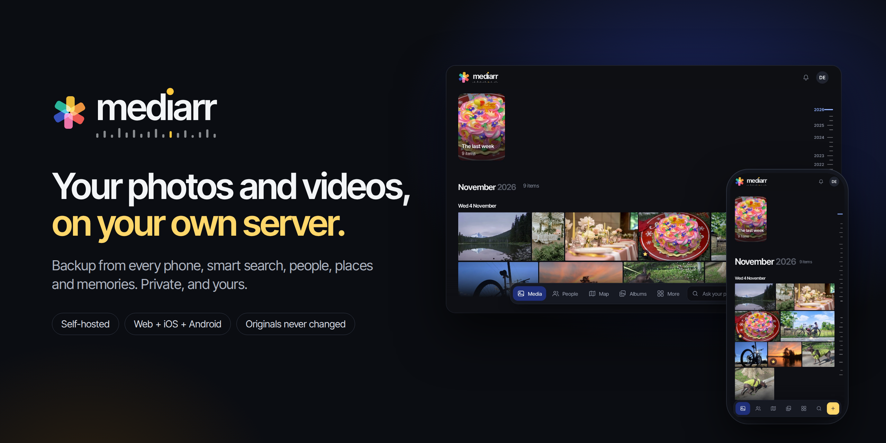
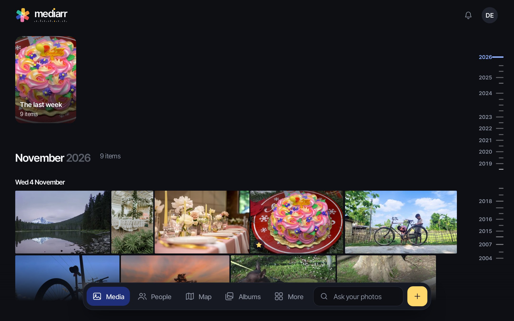
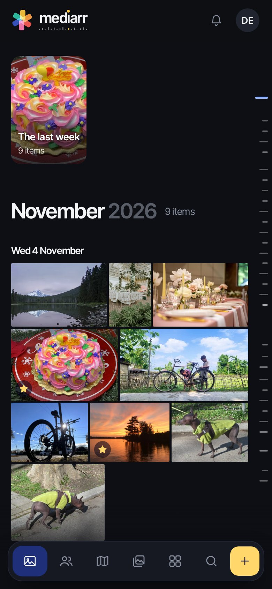
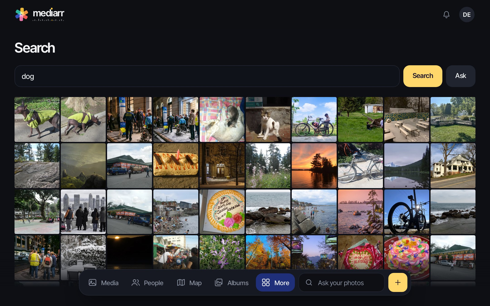
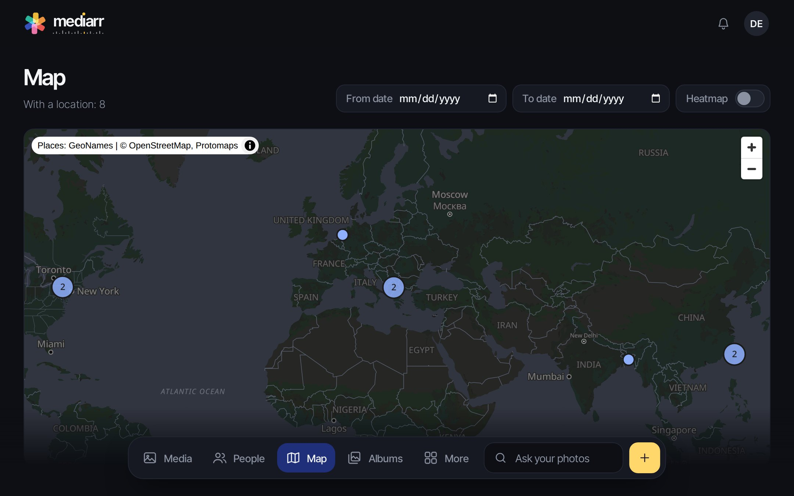
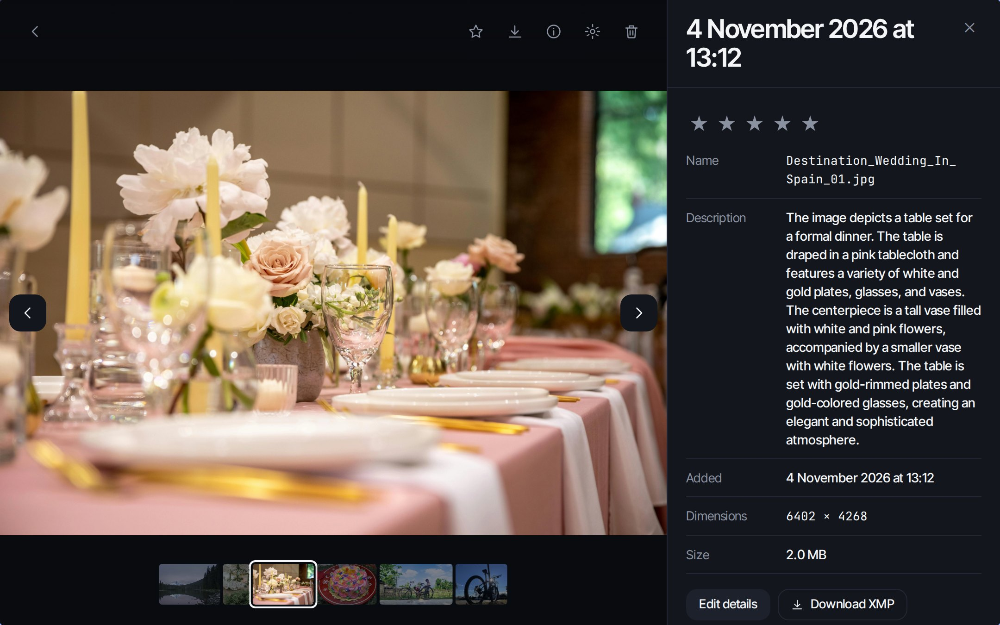
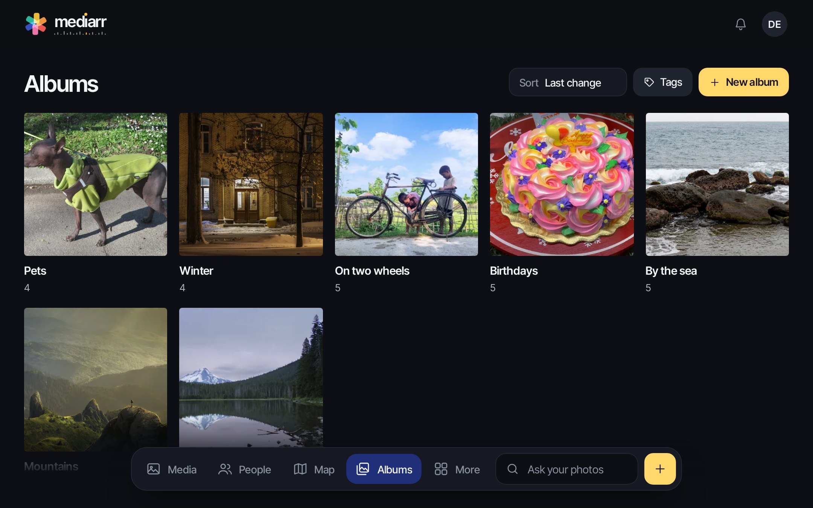
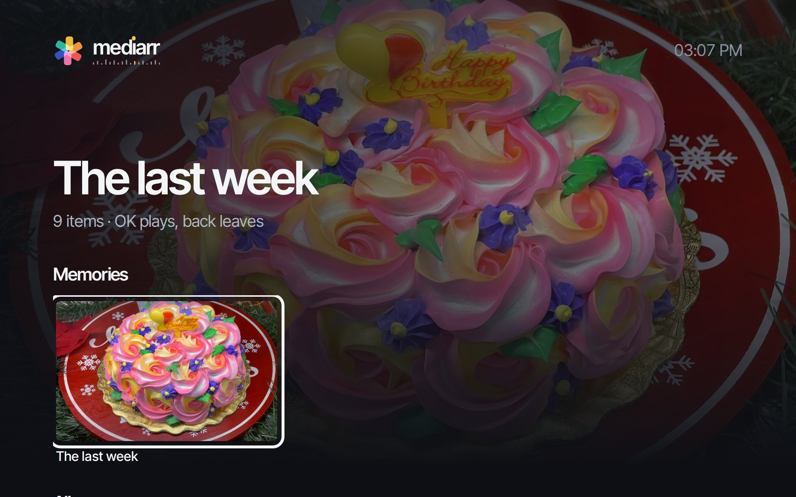

<p align="center">
  
</p>

<p align="center">
  <a href="https://github.com/mediarr-app/mediarr/tags"></a>
  <a href="https://github.com/mediarr-app/mediarr/actions/workflows/ci.yml"></a>
  <a href="https://docs.mediarr.app"></a>
  <a href="https://demo.mediarr.app"></a>
  
</p>

<p align="center">
  <a href="https://mediarr.app"><b>Website</b></a> ·
  <a href="https://docs.mediarr.app"><b>Documentation</b></a> ·
  <a href="https://demo.mediarr.app"><b>Live demo</b></a> ·
  <a href="#mobile-apps"><b>Mobile apps</b></a> ·
  <a href="#install-in-five-minutes"><b>Install</b></a>
</p>

---

**Mediarr** is a photo and video library for a family, running on a server you own. Every phone backs itself up to it. You find any picture by describing it, by who is in it, or by where it was taken. You share albums with the people you choose, and look back at your years as memories. The web app and the apps for iPhone and Android do the same things.

Your pictures stay on your disk. There is no account with us, no subscription, and nothing that sends your photos anywhere.

## Why Mediarr

- **Your originals are never changed.** Every edit is kept as a list beside the photo and can be undone at any time. A backup holds the files exactly as your camera made them.
- **A backup you can trust.** Mediarr makes encrypted backups to a disk, S3 or B2, and **Test bringing it back** really restores the newest one and checks every file.
- **A copy at a relative's.** Two Mediarr servers, yours and a relative's or a friend's, keep an encrypted copy of each other, paired with one code. They cannot read your copy, and what is deleted from it is kept for 90 days, so not even someone who takes over your server can wipe it out at once.
- **Leave Google Photos and iCloud in one step.** Anyone in the family uploads the ZIP files of their Google Takeout or iCloud export, as they came. Dates, time zones, places, descriptions, favourites and albums come with them.
- **Clever, and still private.** Smart search, faces, places, text inside pictures and AI descriptions all run on your own server.
- **It runs anywhere.** Mediarr opens at `http://your-server-ip:9851`. A domain name and HTTPS are up to you, whenever you like.

## Have a look

<table>
  <tr>
    <td colspan="2"></td>
    <td rowspan="2" width="24%"></td>
  </tr>
  <tr>
    <td width="38%"></td>
    <td width="38%"></td>
  </tr>
  <tr>
    <td></td>
    <td></td>
    <td></td>
  </tr>
  <tr>
    <td align="center"><sub>Every detail of a photo, and edits that never touch it</sub></td>
    <td align="center"><sub>Albums to keep and to share</sub></td>
    <td align="center"><sub>Memories on the TV</sub></td>
  </tr>
</table>

## Try it first

Open [demo.mediarr.app](https://demo.mediarr.app) and sign in. The demo is read only.

| Email | Password |
| --- | --- |
| `demo@mediarr.app` | `mediarr-demo` |

## Install in five minutes

You need Linux and Docker Compose 2.23.1 or newer.

```bash
mkdir -p ~/mediarr && cd ~/mediarr
curl -fsSL -o docker-compose.yml https://cdn.mediarr.app/install/docker-compose.yml
curl -fsSL -o .env https://cdn.mediarr.app/install/example.env
```

In `.env`, set a database password and say where your files go. Make those folders, then start it:

```bash
docker compose up -d
```

Open `http://your-server-ip:9851` and create the first account. These two files are all a server needs: nothing is built from source and there is nothing else to configure. The [installation guide](https://docs.mediarr.app/install/docker-compose) has every step, and [updating](https://docs.mediarr.app/install/upgrading) is `docker compose pull && docker compose up -d`.

## Everything it does

| | Web | Mobile |
| --- | :-: | :-: |
| **Your library** | | |
| Automatic backup of the phone, in the background | | ✓ |
| Timeline with a film edge to jump through the years | ✓ | ✓ |
| Albums, favourites, star ratings, archive and trash | ✓ | ✓ |
| Locked vault with its own PIN | ✓ | ✓ |
| Editing that never changes the original | ✓ | ✓ |
| Duplicates and stacks of similar shots | ✓ | ✓ |
| Memories, shown as stories | ✓ | ✓ |
| Your profile: picture, name and email | ✓ | ✓ |
| **Finding things** | | |
| Smart search in plain language, in many languages | ✓ | ✓ |
| Text inside pictures | ✓ | ✓ |
| People, found by faces recognised on your server | ✓ | ✓ |
| Map, places and trips, worked out offline | ✓ | ✓ |
| AI descriptions, with a local model | ✓ | ✓ |
| Ask your photos a question, answered by the local model | ✓ | |
| **Sharing** | | |
| Partners, shared albums with comments, and public links | ✓ | ✓ |
| Upload links, so guests can add their photos to an album | ✓ | ✓ |
| Family library | ✓ | ✓ |
| TV mode, and a kiosk slideshow for a screen on the wall | ✓ | |
| **Bringing photos in** | | |
| Google Takeout and iCloud, from their ZIP files, for anyone | ✓ | follows |
| Immich, through its API, with albums, favourites and people | ✓ | |
| External libraries, read only | ✓ | ✓ |
| **Keeping them safe** | | |
| Encrypted backups to a disk, S3 or B2, with a real restore test | ✓ | ✓ |
| A copy at another Mediarr, paired with a code or a QR code | ✓ | ✓ |
| Checks that every original is still whole | ✓ | |
| **Running it** | | |
| Single sign-on, two-factor sign-in and API keys | ✓ | ✓ |
| Passkeys | ✓ | |
| Users, storage limits and an activity log | ✓ | |
| Webhooks and Prometheus metrics | ✓ | |

*follows: the app shows an import's progress and report, and can stop and continue it; the ZIP files are uploaded from a computer.*

Smart search, faces and AI descriptions are optional. Everything else works without them.

## Your privacy

- Your files stay on your disk, and originals are read only.
- Search, faces, places and AI descriptions all run on your server.
- A copy kept by another Mediarr is encrypted with your password before it leaves; the other server cannot open it.
- By default there are two outside requests, and neither carries your photos: the map's background from `cdn.mediarr.app`, and a check for a new version on GitHub. You can change or turn off both.

## How much it needs

Measured on a small library:

| Part | Memory | Disk for the image |
| --- | --- | --- |
| Server, worker and database | About 300 MB | About 1.1 GB |
| Smart search and faces, optional | About 950 MB idle | 832 MB, and about 1 GB of models |
| AI descriptions, optional | About 8.8 GB while working | 8.5 GB, and the models |

Keep the images on a disk with a few GB free: an update downloads the new ones before it starts them.

## Mobile apps

| Platform | Download |
| --- | --- |
| Android | [mediarr.apk](https://cdn.mediarr.app/apps/mediarr.apk) |
| iPhone | [mediarr.ipa](https://cdn.mediarr.app/apps/mediarr.ipa), installed with a sideloading app such as Feather |

Sign in with the address of your server, as you open it in the browser. The app backs up the photos you choose, in the background, and frees space on the phone only for what the server has.

## Documentation

- [Requirements](https://docs.mediarr.app/install/requirements) and [installation](https://docs.mediarr.app/install/docker-compose)
- [Domain and HTTPS](https://docs.mediarr.app/administration/reverse-proxy)
- [Import from Google Photos, iCloud or Immich](https://docs.mediarr.app/features/import)
- [Backup and restore](https://docs.mediarr.app/administration/backup) and [a copy at a relative's](https://docs.mediarr.app/administration/keep)
- [The mobile app](https://docs.mediarr.app/features/mobile-app)
- [FAQ](https://docs.mediarr.app/faq)

## In this repository

| Folder | Contents |
| --- | --- |
| [`server/`](server) | API and background worker, in Go |
| [`web/`](web) | Web interface, in SvelteKit |
| [`machine-learning/`](machine-learning) | Search and face recognition, in Python |
| [`open-api/`](open-api) | API definition, the one source of every client |
| [`docker/`](docker) | `docker-compose.yml` and `example.env` |

## Security

Please report a vulnerability privately. See [SECURITY.md](SECURITY.md).

## License

Mediarr is free to install and run for your own use, from the official builds. The source code is public to read, but it is not open source: copying, changing or redistributing it needs written permission. See [LICENSE](LICENSE).

<p align="center"><br><br><b>Your memories belong to you.</b></p>
